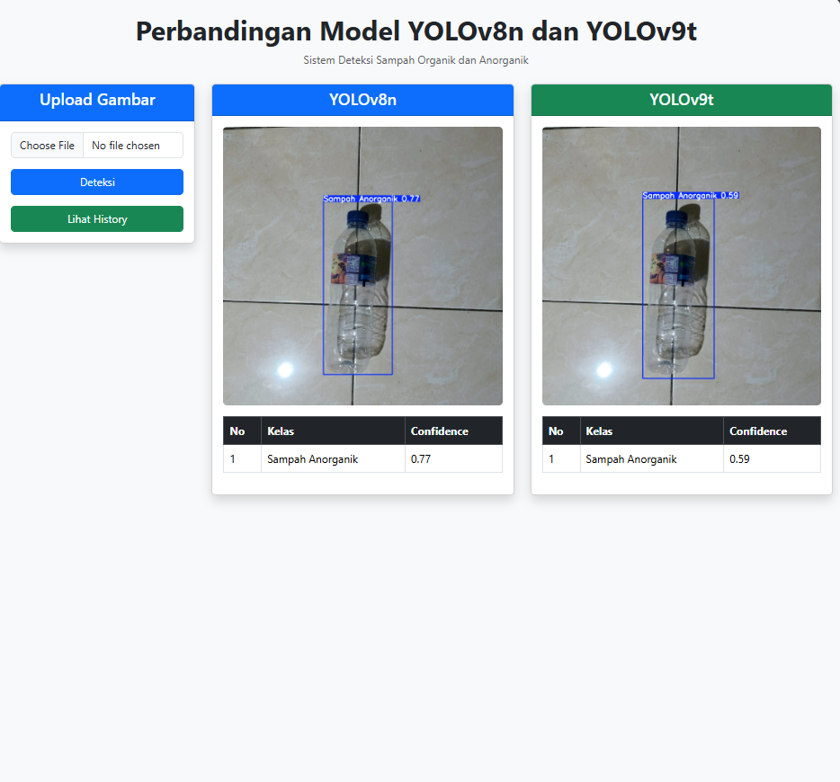
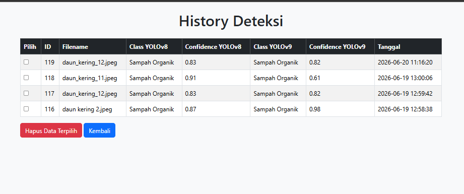

# Perbandingan Model YOLOv8n dan YOLOv9t pada Sistem Deteksi Sampah Organik dan Anorganik

## Deskripsi Proyek

Proyek ini merupakan aplikasi berbasis web untuk mendeteksi dan mengklasifikasikan sampah ke dalam dua kategori, yaitu sampah organik dan sampah anorganik. Sistem ini menggunakan dua model deteksi objek, yaitu YOLOv8n dan YOLOv9t.

Aplikasi memungkinkan pengguna mengunggah gambar sampah untuk diproses oleh kedua model. Hasil deteksi ditampilkan secara berdampingan dalam bentuk bounding box, nama kelas, dan nilai confidence sehingga pengguna dapat membandingkan hasil prediksi dari masing-masing model.

## Cakupan dan Batasan Deteksi

Dataset yang digunakan dalam penelitian ini terdiri dari dua kelas, yaitu:

- **Sampah Organik:** Objek sampah organik yang digunakan dalam dataset berupa daun kering.
- **Sampah Anorganik:** Objek sampah anorganik sesuai dengan variasi objek yang terdapat dalam dataset penelitian.

Oleh karena itu, kemampuan deteksi sampah organik pada aplikasi ini terbatas pada objek daun kering yang telah dipelajari oleh model. Sistem belum ditujukan untuk mengenali seluruh jenis sampah organik, seperti sisa makanan, kulit buah, atau limbah organik lainnya.

## Teknologi yang Digunakan

- Python
- Flask
- MySQL
- YOLOv8n
- YOLOv9t
- HTML

## Fitur Aplikasi

- **Upload Gambar:** Pengguna dapat mengunggah gambar untuk diproses oleh sistem.
- **Deteksi Sampah:** Mendeteksi dan mengklasifikasikan objek ke dalam kelas sampah organik dan anorganik berdasarkan dataset penelitian.
- **Perbandingan Model:** Menampilkan hasil deteksi YOLOv8n dan YOLOv9t secara berdampingan.
- **Confidence Score:** Menampilkan nilai confidence dari hasil prediksi setiap model.
- **Riwayat Deteksi:** Menampilkan hasil deteksi yang telah dilakukan sebelumnya.
- **Hapus Riwayat:** Memungkinkan pengguna menghapus data riwayat deteksi.

## Dokumentasi Aplikasi

### 1. Tampilan Hasil Deteksi

Halaman ini menampilkan hasil deteksi objek sampah dari gambar yang diunggah oleh pengguna. Hasil prediksi dari YOLOv8n dan YOLOv9t ditampilkan secara berdampingan untuk memudahkan perbandingan hasil deteksi kedua model.

### 2. Tampilan Riwayat Deteksi

Halaman riwayat digunakan untuk menampilkan hasil deteksi yang telah dilakukan sebelumnya. Informasi yang tersedia meliputi nama file, kelas hasil deteksi dari masing-masing model, nilai confidence, serta tanggal dan waktu deteksi.

Pengguna juga dapat memilih dan menghapus data riwayat deteksi.

